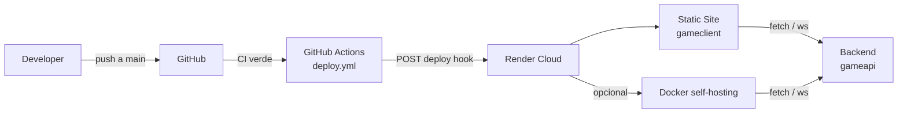

# Guía de despliegue del frontend

Cómo publicar el cliente SvelteKit en producción. El repositorio produce dos artefactos a partir del mismo código: un sitio estático servido por el CDN de Render y una imagen Docker para self-hosting. Esta guía cubre ambos caminos, el endurecimiento aplicado y los pasos exactos para dejar el frontend en línea.

## Instancia de referencia

La referencia operativa del equipo queda en la siguiente configuración:

| Recurso                       | URL                                                   |
| ----------------------------- | ----------------------------------------------------- |
| Frontend (Render Static Site) | `<la URL real del frontend en Render>`                |
| Backend                       | <https://gameapi-9vos.onrender.com>                   |
| WebSocket gameplays           | `wss://gameapi-9vos.onrender.com/api/v2/ws/gameplays` |
| WebSocket presence            | `wss://gameapi-9vos.onrender.com/api/v2/ws/presence`  |

El frontend y el backend comparten el mismo origen de datos y la misma capa de autenticación; el cliente solo cambia la forma en que se publica.

## Arquitectura de despliegue



**Principios:**

1. El artefacto estático se publica en Render con `runtime: static` y se sirve desde `./build`.
2. La imagen Docker usa `adapter-node` y `node build` para servir el artefacto generado por `pnpm build`.
3. `src/hooks.server.ts` falla rápido si `NODE_ENV=production` y `ORIGIN` apunta a `localhost`.
4. Los headers de seguridad se aplican en dos mecanismos distintos: el CDN de Render y el runtime del servidor Node.

## Requisitos previos

- Cuenta en [Render](https://render.com) y acceso al repositorio `gameclient` en GitHub.
- Node 22+ y `pnpm` 9+ instalados localmente.
- Docker Engine con `docker compose` disponible.
- `curl` para validar el health check y los endpoints públicos.

## Paso 1 — Artefactos y compilación

El proyecto produce dos artefactos desde el mismo código fuente:

- `pnpm build:static` usa `scripts/build-static.mjs` para cambiar temporalmente la configuración de SvelteKit y compilar un sitio estático con `adapter-static`.
- `pnpm build:node` ejecuta el build normal con `adapter-node`, Genera el artefacto que luego sirve `node build` en Docker.
- `src/routes/health/+server.ts` define `prerender = true`, por lo que el `/health` está disponible tanto en el artefacto estático como en el Node runtime.

Comandos de referencia:

```bash
pnpm install --frozen-lockfile
pnpm build:static
pnpm build:node
pnpm preview:static
```

El script estático hace exactamente esto:

```js
// scripts/build-static.mjs
const defaultConfigPath = resolve(projectRoot, 'svelte.config.js');
const staticConfigPath = resolve(projectRoot, 'svelte.config.static.js');

await writeFile(defaultConfigPath, staticConfig, 'utf-8');
execSync('pnpm exec vite build', {
  cwd: projectRoot,
  stdio: 'inherit',
  env: { ...process.env, NODE_ENV: 'production' }
});
```

> `preview:static` usa `npx --yes serve@14.2.1 build`, por lo que el artefacto estático queda servido en el puerto default del comando `serve`.

## Paso 2 — Ruta A: Render Static Site

El despliegue del sitio estático está definido en `render.yaml`.

### Configuración clave

```yaml
services:
  - type: web
    name: gameclient
    runtime: static
    buildCommand: pnpm install --frozen-lockfile && pnpm build:static
    staticPublishPath: ./build
    routes:
      - type: rewrite
        source: /*
        destination: /index.html
```

El `buildCommand` compila el sitio estático y el `staticPublishPath` publica `./build`. La ruta `source: /*` con `destination: /index.html` permite que las rutas internas del SPA se resuelvan con una sola página de entrada.

### Variables `PUBLIC_*` y headers

Estos valores se definen en `render.yaml` como `envVars` y se inyectan al bundle durante el build:

| Variable                    | Valor en Render                     | Nota                                                  |
| --------------------------- | ----------------------------------- | ----------------------------------------------------- |
| `PUBLIC_API_BASE`           | `https://gameapi-9vos.onrender.com` | Base HTTP del backend                                 |
| `PUBLIC_WS_BASE`            | `https://gameapi-9vos.onrender.com` | Base WebSocket del backend                            |
| `PUBLIC_REQUEST_TIMEOUT_MS` | `15000`                             | Timeout global del cliente HTTP                       |
| `PUBLIC_LOG_ADMIN_EMAILS`   | `sync: false`                       | Se deja definido por el entorno, no por `render.yaml` |

La seguridad del CDN también se define allí con los mismos cuatro headers:

```yaml
headers:
  - path: /*
    name: X-Frame-Options
    value: DENY
  - path: /*
    name: X-Content-Type-Options
    value: nosniff
  - path: /*
    name: Referrer-Policy
    value: strict-origin-when-cross-origin
  - path: /*
    name: Permissions-Policy
    value: camera=(), microphone=(), geolocation=(), interest-cohort=()
```

### CI/CD del frontend

La automatización vive en `.github/workflows/deploy.yml`:

```yaml
on:
  workflow_run:
    workflows: ['CI']
    types:
      - completed
    branches:
      - main
```

Cuando `CI` termina con éxito en la rama `main`, el workflow hace `curl` al `RENDER_DEPLOY_HOOK_WEB` configurado como secreto. Es decir, el deploy no se dispara por un push directo a Render; el desencadenante es GitHub Actions.

### Verificación rápida del sitio estático

```bash
pnpm build:static
pnpm preview:static
curl -fsS http://127.0.0.1:3000/health
```

La respuesta esperada es:

```json
{ "status": "ok" }
```

## Paso 3 — Ruta B: Docker self-hosting

La segunda vía es la imagen Docker definida en `Dockerfile` y la composición en `docker-compose.yml`.

### Build y arranque

```bash
docker compose up -d --build
```

Eso levanta el contenedor `frontend` con `PORT=3000` y `HOST=0.0.0.0` y sirve el artefacto de `adapter-node`.

### Variables de runtime y ORIGIN

El contenedor configura estas variables con valores por defecto en `docker-compose.yml`:

```yaml
environment:
  PORT: 3000
  HOST: 0.0.0.0
  ORIGIN: ${ORIGIN:-http://localhost:3000}
  ADDRESS_HEADER: ${ADDRESS_HEADER:-}
  PROTOCOL_HEADER: ${PROTOCOL_HEADER:-}
  HOST_HEADER: ${HOST_HEADER:-}
  SKIP_ORIGIN_GUARD: ${SKIP_ORIGIN_GUARD:-true}
```

`ORIGIN` es obligatorio para `adapter-node`. El guard en `src/hooks.server.ts` falla el inicio cuando:

- `NODE_ENV=production`
- `SKIP_ORIGIN_GUARD !== 'true'`
- `ORIGIN` no está definido o apunta a `localhost`, `127.0.0.1` o `0.0.0.0`

```ts
export function validateOrigin(env: NodeJS.ProcessEnv): void {
  if (env.NODE_ENV !== 'production') return;
  if (env.SKIP_ORIGIN_GUARD === 'true') return;

  const origin = env.ORIGIN;
  if (!origin) {
    throw new Error(
      'ORIGIN must be set when NODE_ENV=production. ' +
        'Set it to the public URL (for example https://app.example.com), ' +
        'or set SKIP_ORIGIN_GUARD=true for local Docker testing only.'
    );
  }

  if (isLocalhostOrigin(origin)) {
    throw new Error(
      `ORIGIN must not point to localhost when NODE_ENV=production. Got: ${origin}. ` +
        'Set ORIGIN to the public URL, or set SKIP_ORIGIN_GUARD=true for local Docker testing only.'
    );
  }
}
```

> Advertencia importante: `SKIP_ORIGIN_GUARD=true` solo sirve para pruebas locales con Docker. No se debe usar en producción. En producción, `ORIGIN` debe ser la URL pública real (`https://app.example.com` o similar), nunca `http://localhost:3000`.

### Headers de proxy inverso

Cuando el frontend se sirve detrás de nginx, Caddy o Traefik, los cabeceros `ADDRESS_HEADER`, `PROTOCOL_HEADER` y `HOST_HEADER` permiten que `adapter-node` reconstruya la solicitud correctamente desde los headers re-enviados por el proxy.

En `docker-compose.yml` están comentados así:

```yaml
# These three headers tell adapter-node which forwarded headers to read
# when it runs behind a reverse proxy. Leave them empty for direct
# access. Set them in .env when self-hosting behind nginx, Caddy, or
# Traefik:
#   ADDRESS_HEADER=X-Forwarded-For
#   PROTOCOL_HEADER=X-Forwarded-Proto
#   HOST_HEADER=X-Forwarded-Host
```

Los valores típicos para un proxy inverso son:

```env
ADDRESS_HEADER=X-Forwarded-For
PROTOCOL_HEADER=X-Forwarded-Proto
HOST_HEADER=X-Forwarded-Host
```

### Seguridad del runtime en Node

El servidor Node aplica una segunda capa de headers de seguridad con `SECURITY_HEADERS` en `src/hooks.server.ts`:

```ts
const SECURITY_HEADERS: Record<string, string> = {
  'X-Frame-Options': 'DENY',
  'X-Content-Type-Options': 'nosniff',
  'Referrer-Policy': 'strict-origin-when-cross-origin',
  'Permissions-Policy': 'camera=(), microphone=(), geolocation=(), interest-cohort=()'
};
```

Esto complementa los headers declarados en `render.yaml` para el artefacto estático. En otras palabras:

- `render.yaml` endurece el sitio estático servido por Render.
- `src/hooks.server.ts` endurece la variante Node/Docker.

### Salud del contenedor

La ruta `src/routes/health/+server.ts` devuelve JSON y está marcada con `prerender = true`:

```ts
export const prerender = true;

export const GET: RequestHandler = () => {
  return new Response(JSON.stringify({ status: 'ok' }), {
    status: 200,
    headers: {
      'Content-Type': 'application/json',
      'Cache-Control': 'no-store'
    }
  });
};
```

El `HEALTHCHECK` del `Dockerfile` llama a `/health` en `127.0.0.1:3000` y el contenedor queda disponible solo si responde con estado `200`.

## Paso 4 — Variables de entorno y decisiones operativas

El proyecto usa dos familias de variables:

| Variable                    | Dónde se usa                 | Tipo                              |
| --------------------------- | ---------------------------- | --------------------------------- |
| `PUBLIC_API_BASE`           | SvelteKit build              | pública, inlined durante el build |
| `PUBLIC_WS_BASE`            | SvelteKit build              | pública, inlined durante el build |
| `PUBLIC_REQUEST_TIMEOUT_MS` | SvelteKit build              | pública, inlined durante el build |
| `PUBLIC_LOG_ADMIN_EMAILS`   | SvelteKit build              | pública, inlined durante el build |
| `ORIGIN`                    | runtime Node                 | obligatoria en producción         |
| `ADDRESS_HEADER`            | runtime Node detrás de proxy | opcional                          |
| `PROTOCOL_HEADER`           | runtime Node detrás de proxy | opcional                          |
| `HOST_HEADER`               | runtime Node detrás de proxy | opcional                          |
| `SKIP_ORIGIN_GUARD`         | runtime local Docker         | solo para pruebas locales         |

### Regla de oro

- Si el frontend se sirve en Render/Static, usa `PUBLIC_*` y `render.yaml`.
- Si el frontend se sirve en Docker/Node, usa `ORIGIN`, el guard de `src/hooks.server.ts` y los headers de proxy inverso.
- Nunca apuntes `ORIGIN` a `localhost` en producción.

## Paso 5 — Checklist previa a la demo

Antes de mostrar la app, ejecuta esta checklist en el entorno que vayas a presentar:

```bash
# 1. Health check del artefacto Docker
curl -fsS http://127.0.0.1:3000/health

# 2. Health check del artefacto estático
pnpm build:static
pnpm preview:static
curl -fsS http://127.0.0.1:3000/health

# 3. Verificar que el bundle está compilandose con las variables correctas
pnpm build:node

# 4. Validar que el frontend usa el backend correcto
curl -fsS https://gameapi-9vos.onrender.com/health
```

La demo queda lista cuando:

- `/health` responde `{"status":"ok"}`.
- El frontend publica la URL pública correcta en `ORIGIN` (si es Docker/Node).
- `ORIGIN` no apunta a `localhost` cuando `NODE_ENV=production`.
- Los `PUBLIC_*` del bundle coinciden con el backend que se quiere probar.
- El proxy inverso o la capa CDN no está expulsando los headers esperados.

## Troubleshooting

### Error de inicio: `ORIGIN must be set when NODE_ENV=production`

Esto ocurre cuando el proceso Node se ejecuta en producción sin una URL pública válida:

```bash
echo "$NODE_ENV"
echo "$ORIGIN"
```

Solución:

```bash
export ORIGIN=https://app.example.com
# o, solo para pruebas locales con Docker:
export SKIP_ORIGIN_GUARD=true
```

Nunca lo dejes como `http://localhost:3000` en producción.

### Error de inicio: `ORIGIN must not point to localhost when NODE_ENV=production`

Este error es intencional. La aplicación está protegiendo un caso inseguro y debe corregirse configurando una URL real:

```bash
export ORIGIN=https://app.example.com
```

### El proxy inverso no detecta el esquema o hostname

Si el frontend está detrás de nginx, Caddy o Traefik, valida estas variables:

```env
ADDRESS_HEADER=X-Forwarded-For
PROTOCOL_HEADER=X-Forwarded-Proto
HOST_HEADER=X-Forwarded-Host
```

### El sitio estático no renderiza rutas internas

Confirma que `render.yaml` conserva el rewrite SPA:

```yaml
routes:
  - type: rewrite
    source: /*
    destination: /index.html
```

### El `/health` no responde

Revisa el estado del contenedor o del servicio:

```bash
docker compose ps
docker compose logs --tail=50 frontend
```

Y luego verifica:

```bash
curl -fsS http://127.0.0.1:3000/health
```

## Resumen

El frontend admite dos caminos claramente separados pero equivalentes en la experiencia de usuario:

- `Render Static Site`: ideal para desplegar un SPA estático con CDN y headers en `render.yaml`.
- `Docker self-hosting`: ideal para servir el mismo frontend con `adapter-node` y un runtime más controlado.

En ambos casos, la combinación correcta de `PUBLIC_*`, `ORIGIN`, `ADDRESS_HEADER`, `PROTOCOL_HEADER`, `HOST_HEADER`, y los headers de seguridad es lo que hace que la entrega sea reproducible, segura y fácil de validar antes de la demo.
