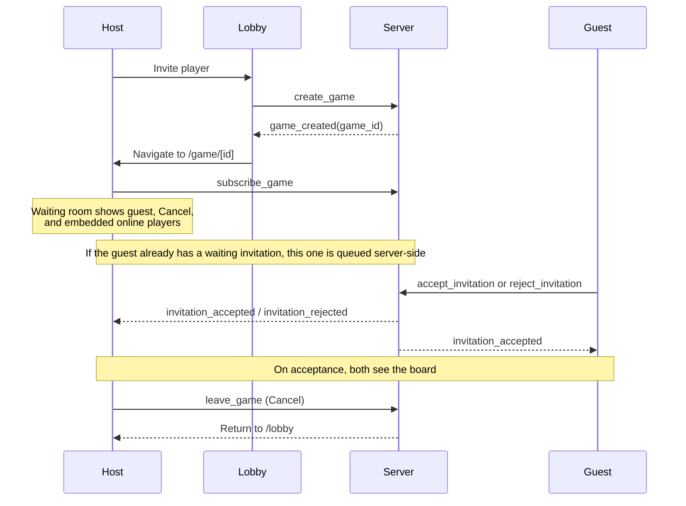

# GameClient

Frontend de SvelteKit para el juego. Este cliente encapsula el acceso HTTP y WebSocket hacia el backend FastAPI para que las pantallas de UI solo consuman módulos de API y stores, sin tener que manejar fetch ni sockets directamente.

## Stack

- SvelteKit
- TypeScript
- Tailwind CSS
- Vitest
- pnpm
- Docker

## Requisitos

- Node 22+
- pnpm 9+
- Docker

## Instalación

```bash
pnpm install
cp .env.example .env
```

## Deployment

La guía completa de despliegue del frontend está en [./.docs/deployment/README.md](./.docs/deployment/README.md). Cubre ambos artefactos del repositorio: el sitio estático en Render y la imagen Docker para self-hosting, con la validación de `ORIGIN`, los headers de proxy inverso y la checklist de pre-demo.

## Security

- Every UUID coming from the backend must pass `isUuid` before being used in routes, redirects, or WS payloads.
- Every user-facing error message must go through `userFacingMessage` before it is rendered.
- Never use `{@html}` with backend data or any untrusted string.
- Client-side debounce is defense in depth; the backend rate limit remains the source of truth for abuse protection.
- The invitation modal uses a focus trap and maps `Escape` to `reject` to keep the flow safe and accessible.

## Comandos con Makefile

| Comando               | Descripción                             |
| --------------------- | --------------------------------------- |
| `make install`        | Instala dependencias con pnpm           |
| `make dev`            | Inicia el servidor de desarrollo        |
| `make build`          | Compila en producción                   |
| `make preview`        | Previsualiza el build                   |
| `make start`          | Sirve el build con adapter-node         |
| `make test`           | Ejecuta los tests                       |
| `make test-cov`       | Ejecuta tests con cobertura             |
| `make lint`           | Ejecuta Prettier y ESLint               |
| `make format`         | Formatea el proyecto                    |
| `make check`          | Ejecuta el typecheck de Svelte          |
| `make clean`          | Elimina cachés y artefactos             |
| `make docker-build`   | Compila la imagen Docker                |
| `make docker-up`      | Levanta el contenedor                   |
| `make docker-down`    | Detiene el contenedor                   |
| `make docker-rebuild` | Reconstruye sin caché y reinicia Docker |
| `make docker-logs`    | Muestra logs del contenedor             |

## Desarrollo

```bash
pnpm dev
```

La aplicación se ejecuta en `http://localhost:5173` y usa el proxy de Vite para redirigir `/api` y `/health` hacia `http://localhost:8080`.

## Invitation flow

After the host sends `create_game`, the server responds with `game_created`.
The host immediately navigates to `/game/[id]` and stays on that route while
the guest decides. The game page renders its waiting room for both pending and
queued invitations.



The waiting room's **Cancel** button sends `leave_game` and returns the host to
`/lobby`. A player who rejects or whose invitation expires or is canceled is
also returned to the lobby with a toast. The waiting room includes an online
players list for challenging another player without leaving the game page.

### Leaving a game route

The game page sends `leave_game` from its Svelte `onDestroy` cleanup when the
route is destroyed. The waiting-room **Cancel** action also sends `leave_game`
before navigating to `/lobby`. The route cleanup retains the shared gameplay
socket; it unsubscribes page handlers and releases page-owned state.

## Online players e invitaciones

El estado compartido de jugadores conectados vive en `src/lib/stores/onlinePlayers.svelte.ts`. Es un store global, basado en el cliente de presencia, y se inicializa una sola vez desde el layout. El resto de las pantallas usa ese estado para listarse y para detectar quién está jugando, sin volver a subscribirse a `online_users` o `user_status`.

```ts
import { onlinePlayers } from '$lib/stores/onlinePlayers.svelte';

onlinePlayers.initialize();
onlinePlayers.refresh();
```

`OnlinePlayersMenu` es un componente reutilizable para mostrar la lista de usuarios activos y ofrecer invitaciones. Acepta props tipadas:

- `title?: string` — encabezado visible del panel.
- `disabled?: boolean` — deshabilita todos los botones de invitación.
- `emptyMessage?: string` — mensaje cuando no hay jugadores disponibles.
- `onInvite?: (user: PublicUser) => void` — callback opcional para invitar.

No renderiza al usuario actual y nunca expone UUIDs en la UI. Cuando `onInvite` no se pasa, el menú funciona en modo solo lectura.

`InvitationHost` centralizes the invitation modal. It mounts once in the layout
and subscribes to the global gameplay-client store, rebinding its event handlers
whenever takeover replaces the client. Pages should not subscribe to
`invitation_*`; the host displays the dialog, accepts or rejects the invitation,
and navigates to the game when accepted.

## Invitation host

- Event handlers are detached from the old gameplay client and registered on
  each replacement published by `globalGameplaysClient`, including after a
  session takeover.
- An unanswered invitation modal closes after 70 seconds. This client-side
  dismissal does not reject the invitation or show an expiration toast; the
  backend TTL and `invitation_expired` event determine when the invitation
  actually expires.
- `sanitizeDisplayName` removes Unicode bidirectional control characters and
  surrounding whitespace before backend-provided names are displayed.
- The layout sets `disabled` while in standby or session conflict. The modal
  closes when disabled, its root becomes `inert`, and accept/reject actions
  cannot be triggered.

## Chat

The client ships a global real-time chat on top of `/api/v2/ws/chat`. The UI
is a floating bubble (`ChatBubble`) that, when opened, mounts a floating
panel (`ChatPanel`) with the latest messages, the connected users count, and
a single-line input. It is mounted once in the root layout and is only
visible on `/lobby`, `/game/[id]`, and `/history`.

### Opening and closing

- **Open**: click the bubble. `chatStore.open()` resolves the access token
  via `bootstrapSession()` and connects the WebSocket.
- **Close**: click the X, press `Escape`, or navigate outside the whitelisted
  routes. `chatStore.close()` disconnects the WebSocket.
- The `open/closed` state is **not** persisted across reloads; the chat
  always starts collapsed.

### In-memory history

Messages live in an in-memory buffer capped at 200 messages or 2 hours,
whichever is hit first. The backend does not persist history: on every
(re)connect, the client receives a `chat_history` frame with the recent
messages and **replaces** the local buffer (server is the source of truth).
On a Render cold start, the server-side buffer is empty and the client
starts with no history.

### Rate limiting

The backend enforces **10 messages / 10 s** per user with a **30 s** block
on excess. The client performs a matching local pre-check with the same
window; if the server responds with `CHAT_RATE_LIMITED`, the panel
disables the input and shows a countdown based on `retry_after_seconds`.

### Session and standby

- When the app enters standby (`session_replaced` or session conflict), the
  panel becomes `inert`, the WebSocket disconnects, and the `open` state is
  preserved. When standby is released, the chat reconnects automatically.
- On `auth_error` with `reason` `invalid_token` or `expired_token`, the
  store attempts a token refresh via `renewSessionToken()`. On failure it
  forwards the error to the global `handleAuthFailure` handler.
- A close with code `4409` (`session_replaced`) cleans up the store without
  invoking `handleAuthFailure`; the layout already redirects to `/login`.

### Environment

No new variables. The endpoint is derived from `PUBLIC_WS_BASE` via
`buildWsUrl('/api/v2/ws/chat')`, same as the gameplay and presence sockets.

## WebSocket reconnection and session replacement

- When a new socket connects for the same session, the previous socket closes
  with code `1000` and reason `reconnected`; this is a normal same-session
  replacement.
- A socket revoked by session takeover closes with code `4409` and reason
  `session_replaced`. The layout enters standby and prevents the replaced
  session from reconnecting.
- Invitation expiry and retry acknowledgements include `updated_at`. The game
  page uses the retry timestamp to ignore older expiry events, preventing a
  delayed event from changing a retried invitation back to `expired`.

## Docker

El cliente incluye un `Dockerfile` multi-stage y un `docker-compose.yml`
para desarrollo local y pruebas. El contenedor sirve el SPA construido
con `adapter-node` en el puerto `3000`.

### Levantar el stack

```bash
make docker-up       # o: docker compose up --build -d
```

Una vez arriba, abre <http://localhost:3000>.

### Build args vs runtime env vars

Las variables `PUBLIC_*` de SvelteKit se inline-an en el bundle **durante
el build**, no se leen en runtime. Por eso se pasan como `build.args` en
`docker-compose.yml` y no como `environment:`. Si solo se definieran en
`environment:`, el SPA se compilaría con valores vacíos y las peticiones
saldrían hacia el propio contenedor (404).

Variables de build:

- `PUBLIC_API_BASE` — Base URL del backend HTTP.
- `PUBLIC_WS_BASE` — Base URL del WebSocket.
- `PUBLIC_REQUEST_TIMEOUT_MS` — Timeout HTTP en milisegundos.

Variables de runtime (leídas por `adapter-node`):

- `PORT` — Puerto de escucha.
- `HOST` — Host de escucha.
- `ORIGIN` — Origen público del servidor (para URLs absolutas y
  redirects).

**Cualquier cambio en las variables de build requiere reconstruir la
imagen**, no solo reiniciar el contenedor:

```bash
docker compose build --no-cache frontend
docker compose up -d
```

### Comunicación con el backend

Dentro del contenedor **no existe el proxy de Vite**. El SPA necesita
URLs absolutas para hablar con el backend. Se configuran mediante dos
variables específicas de Docker:

| Variable                 | Default                 | Descripción                    |
| ------------------------ | ----------------------- | ------------------------------ |
| `DOCKER_PUBLIC_API_BASE` | `http://localhost:8080` | Base URL HTTP del backend      |
| `DOCKER_PUBLIC_WS_BASE`  | `http://localhost:8080` | Base URL WebSocket del backend |

**Nunca** se leen desde `PUBLIC_API_BASE`/`PUBLIC_WS_BASE` porque esos
valores están pensados para el modo `pnpm dev` (donde el proxy de Vite
los resuelve).

### Apuntar el contenedor a un backend desplegado

```bash
DOCKER_PUBLIC_API_BASE=https://gameapi-9vos.onrender.com \
DOCKER_PUBLIC_WS_BASE=https://gameapi-9vos.onrender.com \
docker compose up --build
```

### Apuntar el contenedor a un backend en el host

Cuando el backend corre en tu máquina (por ejemplo con `make dev` en el
repositorio `gameapi`) y el frontend corre en Docker, el contenedor
necesita una dirección para alcanzar el host.

El `docker-compose.yml` ya incluye:

```yaml
extra_hosts:
  - 'host.docker.internal:host-gateway'
```

Esto hace que `host.docker.internal` funcione igual en Linux, macOS y
Windows sin configuración adicional.

Configura el `.env`:

```
DOCKER_PUBLIC_API_BASE=http://localhost:8080
DOCKER_PUBLIC_WS_BASE=http://localhost:8080
```

El navegador es quien realiza las llamadas del SPA. Si el navegador y el
backend están en la misma máquina, debe usar `localhost`; el alias
`host.docker.internal` de `extra_hosts` solo se resuelve dentro de los
contenedores Docker y no en el navegador del host.

La entrada `host.docker.internal:host-gateway` permite verificar desde
el contenedor que se alcanza un backend que escucha en una interfaz del
host. Para comprobarlo, reconstruye y ejecuta `make docker-verify`:

```bash
make docker-rebuild
make docker-verify
```

### CORS en el backend

Cuando el frontend corre en `http://localhost:3000` y llama al backend en
`http://localhost:8080`, la petición es **cross-origin**. El backend debe
permitir ese origen con credenciales:

```
# En el .env del backend
CORS_ORIGINS=http://localhost:3000
```

Si el backend corre con `CORS_ORIGINS=*` y `allow_credentials=True`, el
navegador **rechazará** las respuestas por seguridad. Es una regla del
estándar CORS: no se puede combinar wildcard con credenciales.

### Troubleshooting

**Error 404 en `/api/v2/auth/*` desde el navegador:**

El contenedor está sirviendo el SPA pero no encuentra las rutas de la
API. Confirma que los build args y la URL configurada estén presentes:

```bash
# 1. Confirmar que Compose resolvió los build args
docker compose config | grep -A4 "args:"

# 2. Confirmar que la URL está en el bundle construido
docker compose exec frontend sh -c \
  'grep -roE "host\.docker\.internal:8080|localhost:8080" build/ | head -3'

# 3. Confirmar que el contenedor puede alcanzar el backend en el host
docker compose exec frontend sh -c \
  'wget -qO- http://host.docker.internal:8080/health || echo FAIL'
```

La primera salida debe mostrar las bases URL resueltas. La segunda debe
mostrar al menos una coincidencia con la URL configurada. La tercera
debe devolver `{"status":"ok"}`.

**Error CORS en el navegador:**

El backend no está permitiendo el origen del frontend. Verifica:

```bash
curl -i -X OPTIONS http://localhost:8080/api/v2/auth/login \
  -H "Origin: http://localhost:3000" \
  -H "Access-Control-Request-Method: POST" \
  -H "Access-Control-Request-Headers: content-type"
```

Debe devolver `Access-Control-Allow-Origin: http://localhost:3000` y
`Access-Control-Allow-Credentials: true`.

**Las cookies no se envían al backend:**

Los JWT viajan en cookies `HttpOnly`. Con `SameSite=Lax`, el navegador
las envía en peticiones cross-origin **siempre que ambos hosts
compartan el mismo dominio registrable**. `localhost:3000` y
`localhost:8080` lo comparten, por lo que las cookies funcionan en
local. En producción, si frontend y backend están en dominios
distintos, hay que configurar `SameSite=None; Secure` en el backend y
usar HTTPS.

## Estructura del proyecto

```text
.github/
├── workflows/
│   └── deploy.yml
.env.example
.docs/
├── deployment/
│   └── README.md
Dockerfile
docker-compose.yml
render.yaml
Makefile
package.json
svelte.config.js
svelte.config.static.js
scripts/
├── build-static.mjs
src/
├── app.css
├── app.html
├── hooks.server.ts
├── lib/
│   ├── api/
│   │   ├── client.ts
│   │   ├── errors.ts
│   │   ├── health.ts
│   │   └── ws.ts
│   ├── components/
│   │   └── GameTitle.svelte
│   ├── config.ts
│   ├── stores/
│   │   └── session.ts
│   ├── types/
│   │   ├── api.ts
│   │   └── ws.ts
│   └── index.ts
├── routes/
│   ├── +page.svelte
│   └── health/
│       └── +server.ts
├── vitest-setup.ts
└── app.d.ts
```

## Cliente HTTP y WebSocket

La capa de cliente se compone por capas pequeñas y reutilizables:

- `config`: lee `PUBLIC_*` y construye URLs para HTTP/WS.
- `api/client`: wrapper HTTP con timeout, parseo de JSON, manejo de `204` y errores tipados.
- `api/errors`: `ApiError`, `NetworkError` y `TimeoutError`.
- `api/health`: ejemplo concreto de endpoint de salud.
- `api/ws`: cliente WebSocket con handshake de autenticación, reconexión y ping/pong.
- `stores/session`: estado mínimo del usuario autenticado.

### Uso HTTP

```ts
import type { PublicUser } from '$lib/types/api';
import { httpClient } from '$lib/api/client';

const user = await httpClient.get<PublicUser>('/api/v2/users/USER_ID');
```

Los endpoints de listado de usuarios responden `410 Gone` por privacidad.

### Uso de endpoint concreto

```ts
import { healthApi } from '$lib/api/health';

const status = await healthApi.check();
```

### Manejo de errores

```ts
import { ApiError } from '$lib/api/errors';

try {
  await httpClient.get('/api/v1/profile');
} catch (err) {
  if (err instanceof ApiError && err.isUnauthorized) {
    // redirect o limpieza de sesión
  }
}
```

### Uso WebSocket

```ts
import { createGameplaysClient } from '$lib/api/ws';

const client = createGameplaysClient();
client.connect('jwt-token');

client.on('game_message', (payload) => {
  console.log('message', payload);
});

// cuando la pantalla termina:
client.disconnect();
```

### Variables de entorno

| Variable                    | Descripción                                                                                      |
| --------------------------- | ------------------------------------------------------------------------------------------------ |
| `PUBLIC_API_BASE`           | Base para llamadas HTTP. En desarrollo se deja vacía para usar el proxy de Vite.                 |
| `PUBLIC_WS_BASE`            | Base para WebSockets. En desarrollo se puede dejar vacía para derivarse desde `window.location`. |
| `PUBLIC_REQUEST_TIMEOUT_MS` | Timeout global de cada request HTTP, por defecto `15000`.                                        |

### Variables de entorno y CI

`src/lib/config.ts` lee las variables `PUBLIC_*` de manera defensiva: si
una variable no está definida, se usa un valor por defecto. Esto evita que
`svelte-check` falle en CI cuando no existe `.env`.

Aun así, los pipelines de GitHub Actions y GitLab CI declaran valores
placeholder en sus bloques `env:` y `variables:` para que `svelte-kit sync`
genere los tipos correctamente. Los valores reales se inyectan en el bundle
durante `pnpm build` (en Docker, mediante `build.args`).

### Pruebas

La capa de networking se valida con:

- `msw` para mocks de HTTP.
- `vitest-websocket-mock` para pruebas del cliente WebSocket.

### Reglas para los compañeros de UI

- Importa siempre módulos de endpoint (`healthApi`, `usersApi`, ...) en lugar de hacer `fetch` directo.
- Lee el estado de autenticación desde `$session` y `$isAuthenticated`; no duplicar el estado del usuario en componentes.
- Nunca muestres `email` ni `registerDate` de usuarios distintos al usuario actual; usa el tipo `PublicUser` para esas consultas.
- Instancia clientes WebSocket por pantalla y llama a `disconnect()` en `onDestroy` cuando la vista deje de usarse.

## Tests

```bash
pnpm test
pnpm test:cov
```

La suite de clientes HTTP/WebSocket usa mocks reales y el umbral de cobertura actual es del 70%.

## Lint y calidad

```bash
pnpm lint
pnpm check
pnpm format
```

## Diseño visual

La interfaz usa una estética retro tipo arcade con fondo oscuro y colores neon. Los componentes visuales se mantienen mínimos en D2 para dejar la capa de negocio y la validación del backend bien estabilizada.

### Recursos y créditos

Los sonidos arcade, la tipografía y el favicon están documentados en
[`CREDITS.md`](./CREDITS.md), con sus respectivas licencias (CC0, SIL OFL,
MIT).

## Integración continua

El proyecto usa Vitest y SvelteKit para validar calidad en cada cambio. La cobertura mínima se deja en 70% para evitar regresiones en la capa de cliente.

## Licencia

Este proyecto se distribuye bajo la licencia MIT. Consulte [LICENSE](LICENSE).
