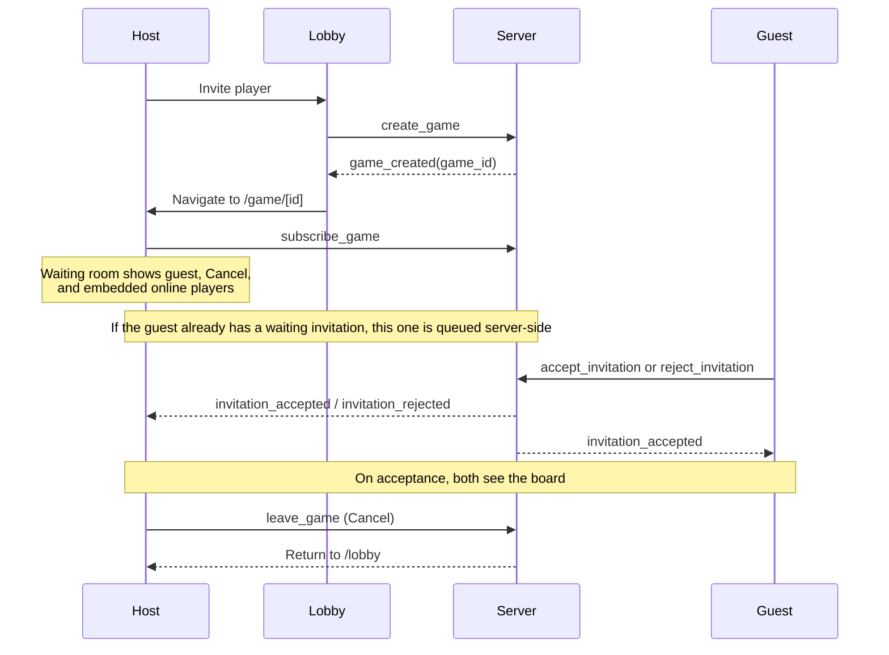

# GameClient

[](https://github.com/JalaU-Capstones/gameclient/actions/workflows/ci.yml)
[](https://codecov.io/gh/JalaU-Capstones/gameclient)
[](https://gameclient-2msz.onrender.com/health)
[](./LICENSE)

The production badge checks `/health` on every render. On the Render free tier the service sleeps after inactivity, so the badge may briefly show "down" during a cold start.

Frontend SvelteKit for the game. This client wraps HTTP and WebSocket access to the FastAPI backend so UI screens only consume API modules and stores instead of directly dealing with fetch or socket logic.

## Stack

- SvelteKit
- TypeScript
- Tailwind CSS
- Vitest
- pnpm
- Docker

## Requirements

- Node 22+
- pnpm 9+
- Docker

## Installation

```bash
pnpm install
cp .env.example .env
```

## Deployment

The full frontend deployment guide lives in [./.docs/deployment/README.md](./.docs/deployment/README.md). It covers both artifacts in the repository: the static site on Render and the Docker image for self-hosting, including `ORIGIN` validation, reverse-proxy headers, and the pre-demo checklist.

## Security

- Every UUID coming from the backend must pass `isUuid` before being used in routes, redirects, or WS payloads.
- Every user-facing error message must go through `userFacingMessage` before it is rendered.
- Never use `{@html}` with backend data or any untrusted string.
- Client-side debounce is defense in depth; the backend rate limit remains the source of truth for abuse protection.
- The invitation modal uses a focus trap and maps `Escape` to `reject` to keep the flow safe and accessible.

## Makefile commands

| Command               | Description                              |
| --------------------- | ---------------------------------------- |
| `make install`        | Install dependencies with pnpm           |
| `make dev`            | Start the development server             |
| `make build`          | Build for production                     |
| `make preview`        | Preview the production build             |
| `make start`          | Serve the build with adapter-node        |
| `make test`           | Run the test suite                       |
| `make test-cov`       | Run tests with coverage                  |
| `make lint`           | Run Prettier and ESLint                  |
| `make format`         | Format the project                       |
| `make check`          | Run the Svelte typecheck                 |
| `make clean`          | Remove caches and build artifacts        |
| `make docker-build`   | Build the Docker image                   |
| `make docker-up`      | Start the container                      |
| `make docker-down`    | Stop the container                       |
| `make docker-rebuild` | Rebuild without cache and restart Docker |
| `make docker-logs`    | Show the container logs                  |

## Development

```bash
pnpm dev
```

The application runs at `http://localhost:5173` and uses the Vite proxy to forward `/api` and `/health` to `http://localhost:8080`. Primary navigation lives in the bottom dock, which is available on every authenticated route except `/login` and `/register`.

## Invitation flow

After the host sends `create_game`, the server responds with `game_created`.
The host immediately navigates to `/game/[id]` and stays on that route while
the guest decides. The game page renders its waiting room for both pending and
queued invitations.



The waiting room's **Cancel** button sends `leave_game` and returns the host to
`/lobby`. A player who rejects or whose invitation expires or is canceled is
also returned to the lobby with a toast. The waiting room includes an online
players list for challenging another player without leaving the game page.

### Leaving a game route

The game page sends `leave_game` from its Svelte `onDestroy` cleanup when the
route is destroyed. The waiting-room **Cancel** action also sends `leave_game`
before navigating to `/lobby`. The route cleanup retains the shared gameplay
socket; it unsubscribes page handlers and releases page-owned state.

## Online players and invitations

The shared connected-player state lives in `src/lib/stores/onlinePlayers.svelte.ts`. It is a global store built on top of the presence client and is initialized once from the layout. The rest of the screens use that state to list themselves and detect who is playing, without re-subscribing to `online_users` or `user_status`.

```ts
import { onlinePlayers } from '$lib/stores/onlinePlayers.svelte';

onlinePlayers.initialize();
onlinePlayers.refresh();
```

`OnlinePlayersMenu` is a reusable component for showing the list of active users and offering invitations. It accepts typed props:

- `title?: string` — visible panel heading.
- `disabled?: boolean` — disables all invitation buttons.
- `emptyMessage?: string` — message shown when no players are available.
- `onInvite?: (user: PublicUser) => void` — optional callback to invite the user.

It does not render the current user and never exposes UUIDs in the UI. When `onInvite` is not passed, the menu works in read-only mode.

`InvitationHost` centralizes the invitation modal. It mounts once in the layout
and subscribes to the global gameplay-client store, rebinding its event handlers
whenever takeover replaces the client. Pages should not subscribe to
`invitation_*`; the host displays the dialog, accepts or rejects the invitation,
and navigates to the game when accepted.

## Invitation host

- Event handlers are detached from the old gameplay client and registered on
  each replacement published by `globalGameplaysClient`, including after a
  session takeover.
- An unanswered invitation modal closes after 70 seconds. This client-side
  dismissal does not reject the invitation or show an expiration toast; the
  backend TTL and `invitation_expired` event determine when the invitation
  actually expires.
- `sanitizeDisplayName` removes Unicode bidirectional control characters and
  surrounding whitespace before backend-provided names are displayed.
- The layout sets `disabled` while in standby or session conflict. The modal
  closes when disabled, its root becomes `inert`, and accept/reject actions
  cannot be triggered.

## Chat

The client ships a global real-time chat on top of `/api/v2/ws/chat`. The UI
is a floating bubble (`ChatBubble`) that, when opened, mounts a floating
panel (`ChatPanel`) with the latest messages, the connected users count, and
a single-line input. It is mounted once in the root layout and is only
visible on `/lobby`, `/game/[id]`, and `/history`.

Note: the bubble sits at `bottom-24` on mobile so it stays clear of the dock,
then returns to `bottom-6` on larger screens where the dock only peeks at the
bottom edge.

### Opening and closing

- **Open**: click the bubble. `chatStore.open()` resolves the access token
  via `bootstrapSession()` and connects the WebSocket.
- **Close**: click the X, press `Escape`, or navigate outside the whitelisted
  routes. `chatStore.close()` disconnects the WebSocket.
- The `open/closed` state is **not** persisted across reloads; the chat
  always starts collapsed.

### In-memory history

Messages live in an in-memory buffer capped at 200 messages or 2 hours,
whichever is hit first. The backend does not persist history: on every
(re)connect, the client receives a `chat_history` frame with the recent
messages and **replaces** the local buffer.

On a Render cold start, the server-side buffer is empty and the client
starts with no history.

### Rate limiting

The backend enforces **10 messages / 10 s** per user with a **30 s** block
on excess. The client performs a matching local pre-check with the same
window; if the server responds with `CHAT_RATE_LIMITED`, the panel
disables the input and shows a countdown based on `retry_after_seconds`.

### Session and standby

- When the app enters standby (`session_replaced` or session conflict), the
  panel becomes `inert`, the WebSocket disconnects, and the `open` state is
  preserved. When standby is released, the chat reconnects automatically.
- On `auth_error` with `reason` `invalid_token` or `expired_token`, the
  store attempts a token refresh via `renewSessionToken()`. On failure it
  forwards the error to the global `handleAuthFailure` handler.
- A close with code `4409` (`session_replaced`) cleans up the store without
  invoking `handleAuthFailure`; the layout already redirects to `/login`.

### Environment

No new variables. The endpoint is derived from `PUBLIC_WS_BASE` via
`buildWsUrl('/api/v2/ws/chat')`, same as the gameplay and presence sockets.

## Docker

The client includes a multi-stage `Dockerfile` and a `docker-compose.yml` file
for local development and testing. The container serves the built SPA with
`adapter-node` on port `3000`.

### Start the stack

```bash
make docker-up       # or: docker compose up --build -d
```

Once it is running, open <http://localhost:3000>.

### Build args vs runtime env vars

The `PUBLIC_*` variables from SvelteKit are inlined into the bundle during the
build, not read at runtime. That is why they are passed as `build.args` in
`docker-compose.yml` instead of as `environment:`. If they were only defined in
`environment:`, the SPA would be built with empty values and requests would go to
its own container (404).

Build variables:

- `PUBLIC_API_BASE` — base URL for the HTTP backend.
- `PUBLIC_WS_BASE` — base URL for the WebSocket backend.
- `PUBLIC_REQUEST_TIMEOUT_MS` — HTTP timeout in milliseconds.

Runtime variables (read by `adapter-node`):

- `PORT` — listen port.
- `HOST` — listen host.
- `ORIGIN` — public origin for the server (for absolute URLs and redirects).

**Any change to the build variables requires rebuilding the image**, not just
restarting the container:

```bash
docker compose build --no-cache frontend
docker compose up -d
```

### Communication with the backend

There is no Vite proxy inside the container. The SPA needs absolute URLs to talk
to the backend. These are configured with two Docker-specific variables:

| Variable                 | Default                 | Description                    |
| ------------------------ | ----------------------- | ------------------------------ |
| `DOCKER_PUBLIC_API_BASE` | `http://localhost:8080` | HTTP base URL for the backend  |
| `DOCKER_PUBLIC_WS_BASE`  | `http://localhost:8080` | WebSocket base URL for backend |

These are **never** read from `PUBLIC_API_BASE`/`PUBLIC_WS_BASE` because those
values are meant for the `pnpm dev` mode, where the Vite proxy resolves them.

### Point the container at a deployed backend

```bash
DOCKER_PUBLIC_API_BASE=https://gameapi-9vos.onrender.com \
DOCKER_PUBLIC_WS_BASE=https://gameapi-9vos.onrender.com \
docker compose up --build
```

### Point the container at a backend on the host

When the backend runs on your machine (for example with `make dev` in the
`gameapi` repository) and the frontend runs in Docker, the container needs an
address to reach the host.

The `docker-compose.yml` already includes:

```yaml
extra_hosts:
  - 'host.docker.internal:host-gateway'
```

This makes `host.docker.internal` work the same way on Linux, macOS, and Windows
without extra configuration.

Configure the `.env` file:

```text
DOCKER_PUBLIC_API_BASE=http://localhost:8080
DOCKER_PUBLIC_WS_BASE=http://localhost:8080
```

The browser makes the SPA requests. If the browser and backend run on the same
machine, it should use `localhost`; the `host.docker.internal` alias in
`extra_hosts` only resolves inside Docker containers and not in the host browser.

The `host.docker.internal:host-gateway` entry lets the container verify that it can
reach a backend listening on a host interface. To confirm it, rebuild and run
`make docker-verify`:

```bash
make docker-rebuild
make docker-verify
```

### CORS on the backend

When the frontend runs at `http://localhost:3000` and calls the backend at
`http://localhost:8080`, the request is **cross-origin**. The backend must allow
that origin with credentials:

```text
# In the backend .env
CORS_ORIGINS=http://localhost:3000
```

If the backend runs with `CORS_ORIGINS=*` and `allow_credentials=True`, the
browser will **reject** the response for security reasons. This is a rule of the
CORS standard: wildcard and credentials cannot be combined.

### Troubleshooting

**Error 404 in `/api/v2/auth/*` from the browser:**

The container is serving the SPA but cannot find the API routes. Confirm that the
build args and configured URL are present:

```bash
# 1. Confirm that Compose resolved the build args
docker compose config | grep -A4 "args:"

# 2. Confirm that the URL is in the built bundle
docker compose exec frontend sh -c \
  'grep -roE "host\.docker\.internal:8080|localhost:8080" build/ | head -3'

# 3. Confirm that the container can reach the backend on the host
docker compose exec frontend sh -c \
  'wget -qO- http://host.docker.internal:8080/health || echo FAIL'
```

The first output should show the resolved base URLs. The second should show at
least one match with the configured URL. The third should return `{"status":"ok"}`.

**CORS error in the browser:**

The backend is not allowing the frontend origin. Check:

```bash
curl -i -X OPTIONS http://localhost:8080/api/v2/auth/login \
  -H "Origin: http://localhost:3000" \
  -H "Access-Control-Request-Method: POST" \
  -H "Access-Control-Request-Headers: content-type"
```

It should return `Access-Control-Allow-Origin: http://localhost:3000` and
`Access-Control-Allow-Credentials: true`.

**Cookies are not being sent to the backend:**

JWTs travel in `HttpOnly` cookies. With `SameSite=Lax`, the browser sends them in
cross-origin requests **as long as both hosts share the same registrable domain**.
`localhost:3000` and `localhost:8080` do, so the cookies work in local
development. In production, if the frontend and backend are on different domains,
configure `SameSite=None; Secure` in the backend and use HTTPS.

## WebSocket reconnection and session replacement

- When a new socket connects for the same session, the previous socket closes
  with code `1000` and reason `reconnected`; this is a normal same-session
  replacement.
- A socket revoked by session takeover closes with code `4409` and reason
  `session_replaced`. The layout enters standby and prevents the replaced
  session from reconnecting.
- Invitation expiry and retry acknowledgements include `updated_at`. The game
  page uses the retry timestamp to ignore older expiry events, preventing a
  delayed event from changing a retried invitation back to `expired`.

## Project structure

```text
.github/
├── workflows/
│   └── deploy.yml
.env.example
.docs/
├── deployment/
│   └── README.md
Dockerfile
docker-compose.yml
render.yaml
Makefile
package.json
svelte.config.js
svelte.config.static.js
scripts/
├── build-static.mjs
src/
├── app.css
├── app.html
├── hooks.server.ts
├── lib/
│   ├── api/
│   │   ├── client.ts
│   │   ├── errors.ts
│   │   ├── health.ts
│   │   └── ws.ts
│   ├── components/
│   │   └── GameTitle.svelte
│   ├── config.ts
│   ├── stores/
│   │   └── session.ts
│   ├── types/
│   │   ├── api.ts
│   │   └── ws.ts
│   └── index.ts
├── routes/
│   ├── +page.svelte
│   └── health/
│       └── +server.ts
├── vitest-setup.ts
└── app.d.ts
```

## HTTP and WebSocket client

The client layer is made of small, reusable building blocks:

- `config`: reads `PUBLIC_*` values and builds URLs for HTTP/WS.
- `api/client`: HTTP wrapper with timeout, JSON parsing, `204` handling, and typed errors.
- `api/errors`: `ApiError`, `NetworkError`, and `TimeoutError`.
- `api/health`: concrete example of a health endpoint.
- `api/ws`: WebSocket client with authentication handshake, reconnection, and ping/pong.
- `stores/session`: minimal state for the authenticated user.

### HTTP usage

```ts
import type { PublicUser } from '$lib/types/api';
import { httpClient } from '$lib/api/client';

const user = await httpClient.get<PublicUser>('/api/v2/users/USER_ID');
```

User listing endpoints answer with `410 Gone` for privacy.

### Endpoint-specific usage

```ts
import { healthApi } from '$lib/api/health';

const status = await healthApi.check();
```

### Error handling

```ts
import { ApiError } from '$lib/api/errors';

try {
  await httpClient.get('/api/v1/profile');
} catch (err) {
  if (err instanceof ApiError && err.isUnauthorized) {
    // redirect or session cleanup
  }
}
```

### WebSocket usage

```ts
import { createGameplaysClient } from '$lib/api/ws';

const client = createGameplaysClient();
client.connect('jwt-token');

client.on('game_message', (payload) => {
  console.log('message', payload);
});

// when the screen ends:
client.disconnect();
```

### Environment variables

| Variable                    | Description                                                                                  |
| --------------------------- | -------------------------------------------------------------------------------------------- |
| `PUBLIC_API_BASE`           | Base for HTTP calls. In development it is left empty to use the Vite proxy.                  |
| `PUBLIC_WS_BASE`            | Base for WebSockets. In development it may be left empty and derived from `window.location`. |
| `PUBLIC_REQUEST_TIMEOUT_MS` | Global timeout for each HTTP request, default `15000`.                                       |

### Environment variables in CI

`src/lib/config.ts` reads the `PUBLIC_*` variables defensively: if a variable is not
set, it falls back to a default. This prevents `svelte-check` from failing in CI when
`.env` is absent.

Even so, the GitHub Actions and GitLab CI pipelines declare placeholder values in
their `env:` and `variables:` blocks so `svelte-kit sync` can generate the types
correctly. The real values are injected into the bundle during `pnpm build` (in
Docker, through `build.args`).

### Networking tests

The networking layer is validated with:

- `msw` for HTTP mocks.
- `vitest-websocket-mock` for WebSocket client tests.

### Guidelines for UI contributors

- Always import endpoint modules (`healthApi`, `usersApi`, ...) instead of calling `fetch` directly.
- Read authentication state from `$session` and `$isAuthenticated`; do not duplicate user state in components.
- Never display `email` or `registerDate` for users other than the current one; use the `PublicUser` type for those queries.
- Instantiate WebSocket clients per screen and call `disconnect()` in `onDestroy` when the view is no longer used.

## Quality

### Tests

The HTTP/WebSocket client suite uses real mocks and the current coverage floor is 70%.

The networking layer is validated with:

- `msw` for HTTP mocks.
- `vitest-websocket-mock` for WebSocket client tests.

The minimum coverage floor is 70% to guard against regressions in the client layer.

```bash
pnpm test
pnpm test:cov
```

### Lint and format

```bash
pnpm lint
pnpm check
pnpm format
```

### CI and release pipeline

| Stage               | Purpose                                            | Trigger              |
| ------------------- | -------------------------------------------------- | -------------------- |
| `quality`           | `pnpm lint` and `pnpm check`                       | every PR and push    |
| `test`              | `pnpm test:cov` on Node 22 and 24                  | every PR and push    |
| `coverage`          | Codecov upload when `CODECOV_TOKEN` is configured  | main branch          |
| `docker`            | Build verification via the production Docker image | main branch and tags |
| `verify-production` | Render health check via `/health`                  | main branch          |

> **`verify-production` timing.** On GitHub Actions, `verify-production` runs
> inside `ci.yml`, _before_ `deploy.yml` triggers the Render deploy. It
> confirms that the **previous** production deploy is reachable, not the one
> this push will produce. That is intentional: `deploy.yml` fires only after
> `CI` succeeds, so verifying the new deploy from inside `CI` would require a
> second workflow. See the `deploy.yml` history for the optional follow-up.

Optional environment variables:

- `CODECOV_TOKEN` — uploads coverage to Codecov when present. Both pipelines
  skip the upload cleanly when the token is missing.
- `PRODUCTION_URL` — URL used by the production health check. Set it as a
  **repository variable** (GitHub: Settings → Secrets and variables → Actions
  → Variables) and a **CI/CD variable** (GitLab: Settings → CI/CD → Variables).
  Defaults to `https://gameclient-2msz.onrender.com` when unset.

## Visual design

The interface uses a dark arcade-inspired aesthetic with neon accents. Visual components stay intentionally minimal so the business logic and backend validation remain the stable core of the experience.

## Resources and credits

The arcade sounds, typeface, and favicon are documented in [`CREDITS.md`](./CREDITS.md), with their respective licenses (CC0, SIL OFL, MIT).

## License

This project is distributed under the MIT license. See [LICENSE](LICENSE).
